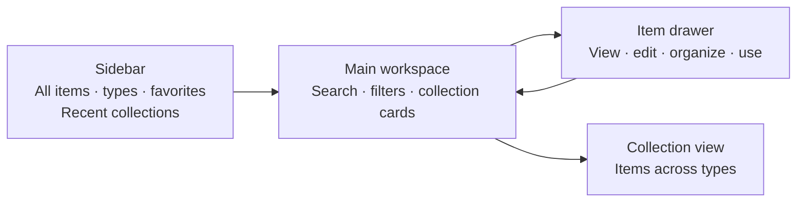
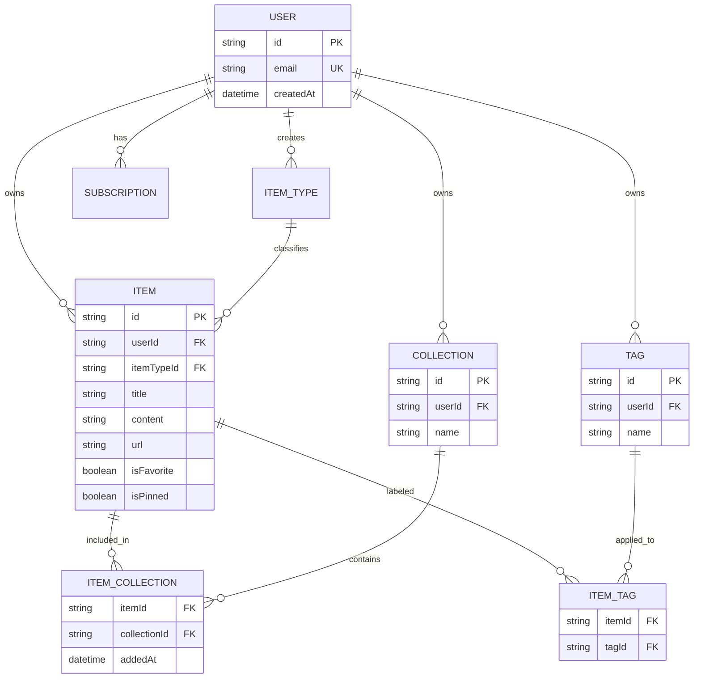
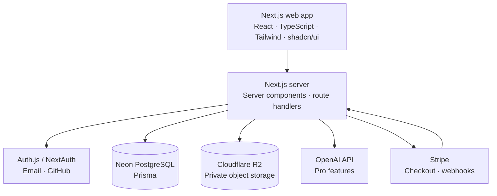

# DevStash — Project Overview

> **Status:** Product and architecture draft
> **Purpose:** A shared reference for product scope, core domain concepts, and the initial technical direction. Treat the Prisma schema as a starting point to validate during implementation.

## 1. Product summary

**DevStash** is a searchable, personal workspace for reusable developer knowledge: code snippets, prompts, notes, commands, links, and (on paid plans) files and images. It reduces context switching by keeping useful material in one place and making it quick to save, find, organize, and reuse.

### Product principles

- **Fast capture:** create or save an item in a lightweight drawer.
- **Findable by default:** search titles, content, types, and tags; use collections for intentional organization.
- **Useful structure, low overhead:** an item can appear in multiple collections without duplication.
- **Private by default:** each account's items, tags, and collections are isolated.
- **Progressive enhancement:** core capture and retrieval work without AI; AI assists rather than owns user data.

## 2. Problem and target users

Developer knowledge is scattered across editors, chat histories, bookmarks, project folders, gists, and shell history. This makes useful material hard to retrieve and encourages repeated work.

| User                | Primary need                                                      |
| ------------------- | ----------------------------------------------------------------- |
| Everyday developer  | Quickly save and retrieve snippets, commands, prompts, and links. |
| AI-first developer  | Keep prompts, context, and repeatable AI workflows organized.     |
| Educator or creator | Store code examples and explanations alongside learning notes.    |
| Full-stack builder  | Reuse patterns, boilerplate, and API examples across projects.    |

## 3. Product scope

### Core item types

The first release uses seeded system types. Their labels and icons are managed by the product. The data model leaves room for user-defined types later, but custom types are a later feature.

| Type    | Content                 | Free plan | Icon           | Accent      |
| ------- | ----------------------- | --------: | -------------- | ----------- |
| Snippet | Text / code             |       Yes | `Code`       | `#3b82f6` |
| Prompt  | Text / Markdown         |       Yes | `Sparkles`   | `#8b5cf6` |
| Command | Text / code             |       Yes | `Terminal`   | `#f97316` |
| Note    | Text / Markdown         |       Yes | `StickyNote` | `#fde047` |
| Link    | URL plus optional notes |       Yes | `Link`       | `#10b981` |
| File    | Object-storage upload   |       Pro | `File`       | `#6b7280` |
| Image   | Object-storage upload   |       Pro | `Image`      | `#ec4899` |

Type colors should be used as accents (borders, icons, badges) with accessible foreground contrast, rather than as the only way to communicate type.

### Collections and tags

- A collection groups items of any type. An item can belong to zero or more collections.
- An item can have zero or more tags. Tags are account-scoped and reusable by that account.
- Collections can have a favorite state and an optional default item type for the create flow.
- Items can be favorited and pinned independently. Pinning affects presentation, not access.
- Show an item's collection memberships in its detail drawer and support adding/removing multiple memberships.

### Search and retrieval

Search across title, text content, description, item type, and tags. Include filters for type, collection, favorite, and pinned state. Provide recently used items and useful empty states.

For the first version, PostgreSQL full-text search is a reasonable baseline. Add a dedicated search service only if measured scale or relevance needs justify it. Binary file contents are not included in text search initially.

### Capture and editing

- Create and edit items in a quick drawer.
- Use a Markdown-capable editor for text types; render code with syntax highlighting when a language is known.
- Support importing text/code from a local file.
- Support uploads for file and image types on eligible plans.
- Preserve original filenames as metadata; validate uploads by size and content type.

### AI assistance (Pro)

- Suggest tags for an item.
- Summarize text or explain a code snippet.
- Improve a prompt on explicit user request.

AI results should be previews until the user applies them. Send only the content needed for the requested operation, disclose that content is processed by an AI provider, and avoid storing provider responses unless the user saves them. Add rate limits, request size limits, and clear error handling.

### Accounts and billing

- Email/password and GitHub sign-in.
- Use a maintained authentication library and its supported password hashing and session flows; never store plaintext passwords.
- Use a payment provider such as Stripe for recurring billing. Keep plan entitlement derived from subscription state rather than a manually maintained `isPro` boolean.
- During development, entitlement checks can be bypassed behind an explicit development configuration. Do not ship that bypass enabled in production.

## 4. Plans and entitlements

| Capability                                                |     Free |                           Pro (proposed) |
| --------------------------------------------------------- | -------: | ---------------------------------------: |
| Items                                                     | 50 total |                               Unlimited* |
| Collections                                               |        3 |                               Unlimited* |
| System text and link types                                |      Yes |                                      Yes |
| File and image uploads                                    |       No |                                      Yes |
| AI tag suggestions, code explanation, prompt optimization |       No |                                      Yes |
| Export                                                    |       No |                               JSON / ZIP |
| Custom types                                              |    Later |           Later / plan decision required |
| Support                                                   | Standard | Priority (operational definition needed) |

**Proposed price:** `$8/month` or `$72/year`. Confirm currency, tax handling, cancellation behavior, grace period, and whether “unlimited” has fair-use limits before launch. Enforce entitlements on the server for every write and paid operation; hiding UI controls is not enforcement.

## 5. Information architecture and UX

### Primary layout



- Desktop: collapsible sidebar and a focused main workspace.
- Mobile: sidebar becomes a navigation drawer; item detail uses a full-height sheet or page.
- Provide global search and a clear create action from the main workspace.
- Collection cards may use the dominant item type as a subtle accent, but must remain readable when collections contain mixed types.
- Dark mode is the default; offer light mode and respect system preference on first visit.
- Include keyboard access, visible focus states, reduced-motion support, and accessible labels for icon-only controls.
- Use loading skeletons, action toasts, and subtle transitions. Avoid making motion necessary to understand state.

### Suggested route structure

Prefer routes organized around the resource, for example:

- `/items` — all items and search
- `/items?type=snippet` — filtered items
- `/items/[itemId]` — item detail/deep link
- `/collections/[collectionId]` — collection contents
- `/settings/billing` — plan and subscription

`/items/snippets` is ambiguous if item IDs can be strings; query filters or a dedicated `/types/snippet` route are clearer. Choose one convention and keep URLs stable.

## 6. Domain model

### Relationship diagram



### Prisma schema (initial draft)

This schema illustrates the core relational model and NextAuth Prisma Adapter tables. It is not a migration. Confirm the exact adapter and Prisma 7 setup against the versions selected for implementation. In Prisma 7, connection configuration is handled by the client/config setup; keep secrets out of the schema and source control.

```prisma
generator client {
  provider = "prisma-client"
  output   = "../src/generated/prisma"
}

datasource db {
  provider = "postgresql"
}

enum ItemContentKind {
  TEXT
  URL
  FILE
}

enum SubscriptionStatus {
  INCOMPLETE
  TRIALING
  ACTIVE
  PAST_DUE
  CANCELED
  UNPAID
  PAUSED
}

model User {
  id            String        @id @default(cuid())
  name          String?
  email         String?       @unique
  emailVerified DateTime?
  image         String?
  createdAt     DateTime      @default(now())
  updatedAt     DateTime      @updatedAt

  accounts      Account[]
  sessions      Session[]
  items         Item[]
  collections   Collection[]
  tags          Tag[]
  customTypes   ItemType[]
  subscriptions Subscription[]
}

// Required by the Auth.js / NextAuth Prisma Adapter.
model Account {
  userId            String
  type              String
  provider          String
  providerAccountId String
  refresh_token     String? @db.Text
  access_token      String? @db.Text
  expires_at        Int?
  token_type        String?
  scope             String?
  id_token          String? @db.Text
  session_state     String?
  user              User    @relation(fields: [userId], references: [id], onDelete: Cascade)

  @@id([provider, providerAccountId])
  @@index([userId])
}

model Session {
  sessionToken String   @unique
  userId       String
  expires      DateTime
  user         User     @relation(fields: [userId], references: [id], onDelete: Cascade)

  @@index([userId])
}

model VerificationToken {
  identifier String
  token      String   @unique
  expires    DateTime

  @@id([identifier, token])
}

model ItemType {
  id        String   @id @default(cuid())
  // Null userId means a seeded system type; non-null means a user-defined type.
  userId    String?
  name      String
  slug      String
  icon      String
  color     String
  isSystem  Boolean  @default(false)
  createdAt DateTime @default(now())
  user      User?    @relation(fields: [userId], references: [id], onDelete: Cascade)
  items     Item[]

  // Seed system rows with stable IDs/slugs. PostgreSQL permits multiple NULLs in this key.
  @@unique([userId, slug])
  @@index([userId])
}

model Item {
  id           String          @id @default(cuid())
  userId       String
  itemTypeId   String
  contentKind  ItemContentKind @default(TEXT)
  title        String
  description  String?         @db.Text
  content      String?         @db.Text
  url          String?
  language     String?
  fileKey      String?         @unique
  fileName     String?
  fileSize     BigInt?
  mimeType     String?
  isFavorite   Boolean         @default(false)
  isPinned     Boolean         @default(false)
  lastUsedAt   DateTime?
  createdAt    DateTime        @default(now())
  updatedAt    DateTime        @updatedAt
  user         User            @relation(fields: [userId], references: [id], onDelete: Cascade)
  itemType     ItemType        @relation(fields: [itemTypeId], references: [id], onDelete: Restrict)
  collections  ItemCollection[]
  tags         ItemTag[]

  @@index([userId, updatedAt])
  @@index([userId, isPinned, updatedAt])
  @@index([userId, isFavorite, updatedAt])
  @@index([userId, lastUsedAt])
  @@index([itemTypeId])
}

model Collection {
  id            String            @id @default(cuid())
  userId        String
  name          String
  description   String?           @db.Text
  isFavorite    Boolean           @default(false)
  defaultTypeId String?
  createdAt     DateTime          @default(now())
  updatedAt     DateTime          @updatedAt
  user          User              @relation(fields: [userId], references: [id], onDelete: Cascade)
  items         ItemCollection[]

  @@unique([userId, name])
  @@index([userId, updatedAt])
}

model ItemCollection {
  itemId       String
  collectionId String
  addedAt      DateTime   @default(now())
  item         Item       @relation(fields: [itemId], references: [id], onDelete: Cascade)
  collection   Collection @relation(fields: [collectionId], references: [id], onDelete: Cascade)

  @@id([itemId, collectionId])
  @@index([collectionId, addedAt])
}

model Tag {
  id        String    @id @default(cuid())
  userId    String
  name      String
  createdAt DateTime  @default(now())
  user      User      @relation(fields: [userId], references: [id], onDelete: Cascade)
  items     ItemTag[]

  @@unique([userId, name])
  @@index([userId])
}

model ItemTag {
  itemId String
  tagId  String
  item   Item   @relation(fields: [itemId], references: [id], onDelete: Cascade)
  tag    Tag    @relation(fields: [tagId], references: [id], onDelete: Cascade)

  @@id([itemId, tagId])
  @@index([tagId])
}

model Subscription {
  id                    String             @id @default(cuid())
  userId                String
  provider              String             @default("stripe")
  providerCustomerId    String
  providerSubscriptionId String?            @unique
  status                SubscriptionStatus
  priceId               String?
  currentPeriodEnd      DateTime?
  cancelAtPeriodEnd     Boolean            @default(false)
  createdAt             DateTime           @default(now())
  updatedAt             DateTime           @updatedAt
  user                  User               @relation(fields: [userId], references: [id], onDelete: Cascade)

  @@index([userId, status])
  @@index([providerCustomerId])
}
```

### Data integrity and access rules

- Every user-owned query must scope through the authenticated `userId`; never trust an owner ID supplied by the browser.
- Validate that an item, collection, and tag belong to the same user before creating join rows. Prisma relations alone do not guarantee same-owner relationships across tables.
- Enforce content invariants in application validation: text items have text content; links have a valid URL; file items have a storage key and metadata. Reject unexpected combinations.
- Store an opaque R2 object key (`fileKey`), not a public URL. Serve files through short-lived signed URLs after checking ownership and entitlement.
- Deleting a user should cascade through their private data and trigger deletion of their stored objects. Define retention and account export/deletion behavior before launch.
- Consider PostgreSQL row-level security only if the team can operate and test it consistently; application-level ownership checks remain required.

## 7. System architecture



### Stack direction

- **Web:** Next.js 16, React 19, TypeScript, Tailwind CSS 4, shadcn/ui.
- **Database:** Neon PostgreSQL with Prisma 7. Use versioned migrations for every schema change; do not use `db push` for shared or production database changes.
- **Authentication:** Auth.js / NextAuth v5 with email/password and GitHub OAuth. Confirm whether email/password means credentials plus a secure password lifecycle or a managed email provider; plan password reset and verification flows.
- **Storage:** Cloudflare R2 for private uploads, accessed via signed upload/download URLs issued by server routes.
- **AI:** OpenAI API, with `gpt-5-nano` as the proposed starting model. Keep provider/model configurable and verify current availability, pricing, and data handling during implementation.
- **Billing:** Stripe subscriptions and signed webhooks as the source of truth for entitlement updates.
- **Caching:** Redis is optional. Start without it unless measured latency, rate limiting, or workload requires it.

Keep the first release in one repository and deployable application. Use server components for read-heavy pages where useful and route handlers/server actions for validated writes and integrations. Avoid exposing database, storage, AI, or payment secrets to client code.

### Upload flow

1. Authenticated client requests an upload authorization for a file item.
2. Server checks plan entitlement, size/type allowlist, and account quota; creates a random object key.
3. Server returns a short-lived signed upload URL for that key.
4. Client uploads directly to private R2 storage.
5. Client confirms completion; server verifies the object and saves metadata to the item record.
6. Downloads use a server-authorized short-lived signed URL.

Set explicit maximum file size and allowed MIME types. Treat the browser-provided MIME type as untrusted and verify the stored object where practical.

## 8. Security, privacy, and reliability

- Apply authentication and ownership checks to every item, collection, tag, upload, export, AI, and billing operation.
- Validate and normalize all user input server-side; use parameterized queries through Prisma.
- Rate-limit sign-in, uploads, AI calls, exports, and other abuse-prone endpoints.
- Keep OAuth secrets, database credentials, R2 credentials, AI keys, and Stripe secrets in environment-managed secret storage.
- Verify Stripe webhook signatures and make webhook handlers idempotent.
- Use least-privilege storage credentials, private buckets, short-lived signed URLs, and upload limits.
- Avoid logging raw prompts, snippets, file contents, session tokens, or payment details. Redact identifiers where possible.
- Establish backups, restore checks, error monitoring, and a process for dependency and security updates.
- Define privacy disclosures, AI processing consent, data export, deletion, and retention before public launch.

## 9. Delivery plan

### Phase 1 — Foundation and MVP

- Auth, account ownership, and seeded system item types.
- Create, edit, delete, and view text, prompt, command, note, and link items.
- Collections, tags, favorites, pinning, and collection membership management.
- Search, type/collection filters, and recently used items.
- Responsive shell, dark/light themes, keyboard and accessibility basics.
- Free plan limits enforced server-side; development entitlement override isolated from production.
- Database migrations, error reporting, backups, and baseline operational monitoring.

### Phase 2 — Pro platform

- Subscription checkout, billing portal, verified webhooks, and entitlement lifecycle.
- Private R2 uploads for file/image items, signed access, quotas, and deletion cleanup.
- JSON export; add ZIP when file export is implemented.
- AI tag suggestions, code explanation, and prompt optimization with explicit user actions and rate limits.

### Phase 3 — Growth and refinement

- Custom item types, if validated by user demand.
- Search relevance improvements and optional Redis/search infrastructure based on metrics.
- Additional import formats, sharing/collaboration, and integrations only after privacy and permission models are defined.

## 10. Product decisions to resolve

1. Is the product strictly single-user/personal at launch, or are shared collections planned? The current model assumes private personal workspaces.
2. Should a link item store its URL in a dedicated field (recommended) and optionally keep commentary in `description`?
3. What are upload size, MIME type, and total storage limits for Pro?
4. Does Free include JSON export, or is all export a Pro feature? Current plan notes say export is Pro.
5. How should billing behave after cancellation, payment failure, or expiration, especially for items beyond Free limits?
6. Which exact authentication provider supports email/password and account recovery in the chosen Auth.js setup?
7. What data is sent to OpenAI, and what user-facing disclosure/consent is required?
8. Which launch metrics define success (for example, time to save an item, successful search rate, and weekly retained users)?

## 11. Success measures

Instrument product events with privacy-conscious, minimal metadata. Suggested early measures:

- Time from opening the app to a saved item.
- Search success: a result opened or used after a search.
- Weekly active users who create or retrieve at least one item.
- Collection and tag use as a measure of organization value.
- Free-to-Pro conversion and paid retention, once billing launches.
- Upload and AI operation success rates, latency, and cost per active Pro user.

## 12. References

- [Next.js documentation](https://nextjs.org/docs)
- [React documentation](https://react.dev/)
- [Prisma documentation](https://www.prisma.io/docs)
- [Neon documentation](https://neon.tech/docs)
- [Auth.js documentation](https://authjs.dev/)
- [Cloudflare R2 documentation](https://developers.cloudflare.com/r2/)
- [Stripe Billing documentation](https://docs.stripe.com/billing)
- [OpenAI API documentation](https://platform.openai.com/docs/)
- [Tailwind CSS documentation](https://tailwindcss.com/docs)
- [shadcn/ui documentation](https://ui.shadcn.com/docs)

---

*This document consolidates the planning notes into an implementation-oriented draft. Pricing, provider choices, quotas, and policy details are proposals that should be confirmed before launch.*
